  

Full-stack developer building AI agents & automations — Angular · Ruby on Rails.

## What I do

- **Product engineering, end to end:** working and learning across product decisions, interface design, data modeling, backend and frontend.
- **Full-stack:** Angular and Ruby on Rails, including 2D computer graphics.
- **AI-assisted engineering:** I turn repetitive engineering work into agentic workflows, with AI agents that review, implement and test, plus checks that prove the work. Daily tools: Claude Code, Cursor and GitHub Copilot.

Full-stack Developer at [Molde.me](https://molde.me), a SaaS CAD platform for the fashion industry.

## Featured work

Coming soon: a toolkit of AI agent skills for software development.

## Stack

## Activity

<picture>
  <source media="(prefers-color-scheme: dark)" srcset="https://raw.githubusercontent.com/stefanykitzberger/stefanykitzberger/output/pacman-contribution-graph-dark.svg">
  <source media="(prefers-color-scheme: light)" srcset="https://raw.githubusercontent.com/stefanykitzberger/stefanykitzberger/output/pacman-contribution-graph.svg">
  
</picture>

## Studies

University and course projects (Software Engineering @ Católica SC) live in [stefanykitzberger-study](https://github.com/stefanykitzberger-study).

## Contact

